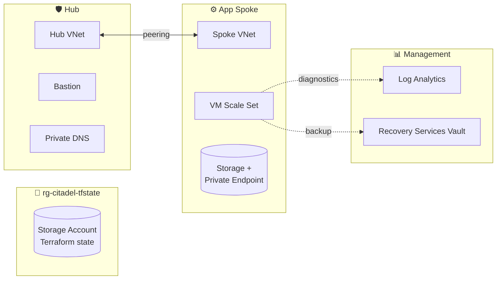

# 🏰 Citadel

> A hardened Azure landing zone, built from scratch with Terraform.

Citadel is my hands-on build of an enterprise-style Azure foundation: governance, networking, compute, storage, monitoring and backup, all as code. It's mapped to the **AZ-104 (Azure Administrator)** skill areas, so every phase is something I've studied *and* built.

---

## 🗺️ Architecture



---

## 🧱 Repo structure

```
├── bootstrap/        # One-off: remote state storage (local state)
├── landing-zone/     # The landing zone itself (remote state in Azure)
└── .github/workflows # CI: fmt + validate on every push
```

## 🔒 Design principles

- **Remote state, locked down:** Entra ID auth only (no storage keys), TLS 1.2, blob versioning, soft delete, `CanNotDelete` lock.
- **Least privilege:** data-plane access granted explicitly (Owner ≠ blob access).
- **Consistent naming:** `<type>-<workload>-<env>-<region>-<role>` → `rg-citadel-dev-aue-hub`
- **Tag everything:** workload, environment, owner, managed_by, purpose.
- **Hub-and-spoke:** shared services in the hub, workloads isolated in spokes.

---

## 🚧 Progress

### Phase 1: Foundations
- [x] Repo structure, `.gitignore`, naming and tagging conventions
- [x] Bootstrap code: hardened state storage
- [ ] Apply bootstrap and verify the lock in the portal
- [ ] Landing zone code: resource groups and remote backend
- [ ] Apply landing zone
- [ ] CI pipeline green ✅

### Phase 2: Identity & Governance
- [ ] Azure Policy: allowed regions, required tags
- [ ] Custom RBAC role assignments
- [ ] Budget and cost alerts

### Phase 3: Networking
- [ ] Hub and spoke VNets + peering
- [ ] NSGs with least-privilege rules
- [ ] Azure Bastion (no public IPs on VMs)
- [ ] Private DNS zones

### Phase 4: Compute
- [ ] VM Scale Set in the app spoke
- [ ] Hardened image / extensions

### Phase 5: Storage
- [ ] Storage account with private endpoint

### Phase 6: Monitoring & Backup
- [ ] Log Analytics workspace + diagnostic settings
- [ ] Alerts
- [ ] Recovery Services Vault + backup policy

### Phase 7: Automation
- [ ] Plan on PR, apply on merge
- [ ] OIDC auth from GitHub Actions (no stored secrets)

---

## 🚀 Deploy it yourself

```bash
az login

# 1. Remote state (run once)
cd bootstrap
cp terraform.tfvars.example terraform.tfvars   # fill in
terraform init && terraform apply

# 2. Landing zone
cd ../landing-zone
cp terraform.tfvars.example terraform.tfvars   # fill in
# create backend.hcl from: terraform -chdir=../bootstrap output -raw backend_hcl
terraform init -backend-config=backend.hcl
terraform plan
```

## 💸 Cost

Phase 1 runs for cents a month. Later phases (Bastion, VMs) cost real money, so `terraform destroy` when not in use.

---

<sub>Built by Arsh Malhi · AZ-104 certified</sub>